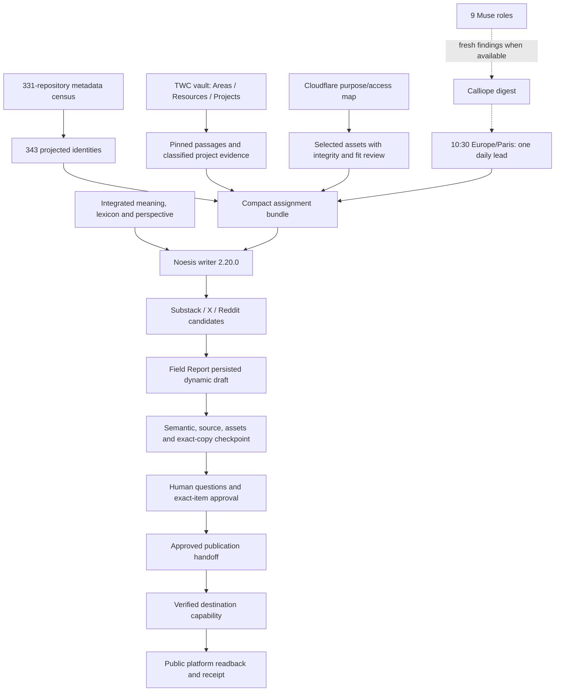

# Connected publishing ecosystem

This map connects the writer, original sources, project identities, assets, Muse roles and human publishing decisions. The writer's philosophical understanding informs what the output means. Each assignment supplies actual evidence and suitable media; exact-copy human approval governs public delivery.

Start with [[SOURCE-MAP|Sources and understanding]], [[PROJECT-MAP|Projects and repository coverage]], or [[PUBLISHING-MAP|Daily preparation, review and delivery]]. Standard Markdown links are supplied below for repository readers. The typed graph is [ecosystem-map.json](ecosystem-map.json); stable node IDs preserve source identities and edges record the relationship and evidence status.

Vault entry: [Publishing ecosystem MOC](/Volumes/madara/2026/twc-vault/_System/MOCs/Publishing-Ecosystem-MOC.md).

## Navigation

| Map | What it answers |
| --- | --- |
| [Sources and understanding](SOURCE-MAP.md) | What the writer reads, how terms retain meaning, which sources are admissible |
| [Projects and repositories](PROJECT-MAP.md) | Which brand owns a work identity and where its metadata comes from |
| [Publishing operation](PUBLISHING-MAP.md) | How daily preparation reaches questions, approval and delivery |
| [Implementation record](../editorial/integrated-publishing-2026-10-09/README.md) | What was implemented and verified |
| [Writer examples](../editorial/integrated-writer-2026-10-09/ANNOTATED-EXAMPLES.md) | How understanding changes sentences and arguments |
| [Machine graph](ecosystem-map.json) | All343 projected source/project identities and their typed connections |

## Evidence boundary

Observed evidence is dated October 9,2026, with the Muse operational crosswalk and earlier publication receipt dated October 8. This map reuses those recorded observations; generating it performs no new account or deployment probe. The graph contains **446 nodes and 1104 edges**: all 343 editorial/project identities,44 work-object/repository links, nine Muse roles, nine purpose-mapped buckets, eleven private media identities and the publishing components. Repository IDs are metadata; private bodies and credentials are absent.

The source projection comprises 127 eligible blog sources, 113 held concept/prepared-copy identities and 103 restricted work identities. The broader331-repository census is linked metadata coverage. These counts do not establish331 integrated runtime projects. Every restricted project needs classified subject evidence before it becomes public writing.

## Current state

- **Verified:** writer canonical/mirror parity, direct passage retrieval, context bundling, private dynamic draft persistence, stale-review rejection and preservation of existing approval records.
- **Configured:** one lead daily at 10:30 Paris, alternating Noesis and Thoughtseed. The schedule is active; a future successful run is a separate observation.
- **Held:** semantic service returned 403; fresh Muse reports and authenticated unattended native Grok exchange remain unverified. Thoughtseed preparation holds when classified project evidence is missing.
- **Human decision pending:** [Before the answer arrives](https://field-report.witnessalchemist.chatgpt.site/details?district=publishing&record=draft%3ATN-LIGHTED-CLEARING-INTEGRATION-PILOT-20261009&page=questions) overlaps the earlier essay and needs a better-fitting cover. It has no publication approval.
- **Recorded public receipt:** [Let the Sentence Finish](https://thewhychromosome.substack.com/p/let-the-sentence-finish), October 8. That receipt is distinct from the held integration pilot.

## Maintaining the map

Refresh and verify the underlying source/asset projections first. Run `python3 docs/ecosystem/build_map.py` from the repository root to rebuild the JSON from those evidence files. The generator checks unique IDs, unique edges and valid endpoints, retaining original source observation dates and SHA256 evidence links. Run `python3 docs/ecosystem/validate_map.py` to verify graph connectivity, local Markdown links and evidence digests. Update these MOC pages when scope or relationships change. Review a changed source's classification and current evidence before admitting its body or making a runtime claim.

This MOC is a navigation projection. Canonical portfolio classification remains in its vault registries; the publication decision and receipt remain in Field Report and the verified platform record.

Historical planning: [full-repertoire plan](../plans/2026-09-30-full-repertoire-editorial-plan.md) · [catalogue](../plans/2026-09-30-editorial-catalogue.md). These are September 30 proposals, retained alongside current source projections and schedule receipts.

## Repository reconciliation

The local tree includes remote workflow migration commit `9e8f0de`: all four GitHub Actions workflows were removed for a local-job migration. Older repository infrastructure prose describing automatic CI deployment is historical until replacement jobs are verified. The 10:30 Paris preparation automation has its own readback; it does not prove replacement deployment/audit jobs. See [bounded reconciliation observation](RECONCILIATION-STATE.json).

The canonical writer received scoped vault commit `95491794c79f64143e7d0aabef358f9fdd56169c`, reported by the reconciliation lane; unrelated staged vault work remains separate. Restored legacy catalogue and full-repertoire editorial plans retain historical proposal status. Local merges and commits are distinct from a remote push, a live deployment or publication approval.
