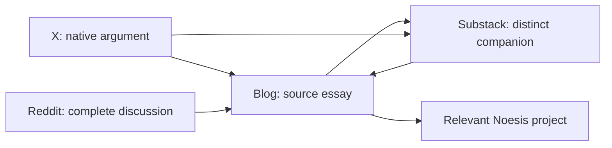

# Supplementary series plan — 8 October 2026

This extends the existing 26-week Thursday calendar. It assigns no additional publication dates and changes no existing schedules. The catalogue covers all 127 files; the first packet has close-read sources. Other episode concepts require their own full source and claim review before drafting.

## The reader journey

Blog essays retain the deep argument. Substack companions work through a fresh consequence, counterexample or practical question, then link to the source and one next essay. X offers a complete small argument and one earned reading link. Reddit starts a useful community discussion; referral traffic is a possible result of relevance, never a condition of understanding the post.

The Reddit arrow applies only when a relevant link is permitted and explicitly approved. Never insert links into a discussion solely to complete this loop. Blog → Substack general subscription cards are already live within articles. Per-essay companion links remain pending actual published URLs, recorded in bridge-manifest.json. No invented permalinks.

## Eight populated lanes and 24 companion concepts

### R — Runtime and self-authorship (19 source posts)

**R-SUP-01: Who can interrupt the routine?.** Locate one decision boundary instead of repeating the legacy-code introduction. Sources: [Reptilian BIOS Architecture](https://synchronocities.tryambakam.space/posts/reptilian-bios-architecture/); [The Three-Layer Consciousness Stack](https://synchronocities.tryambakam.space/posts/three-layer-consciousness-stack/)

**R-SUP-02: An error code is a question, not a diagnosis.** Use one ordinary failed expectation; separate useful metaphor from clinical labels. Sources: [200 OK: Your Guide to Mental Status Codes](https://synchronocities.tryambakam.space/posts/200-ok-mental-status-codes/); [Your Consciousness Needs Better Error Handling](https://synchronocities.tryambakam.space/posts/your-consciousness-needs-better-error-handling/)

**R-SUP-03: The people who made the work possible.** Follow relational conditions of authorship; verify every personal detail with the author. Sources: [The Source Code Has Authors](https://synchronocities.tryambakam.space/posts/the-source-code-has-authors/); [Compassion Runtime: The Limbic Kernel and the Architecture of Emotional Memory](https://synchronocities.tryambakam.space/posts/compassion-runtime/)

### P — The pattern laboratory (13 source posts)

**P-SUP-01: The exception belongs in the log.** Develop counterexamples, unlike the already scheduled introduction to recording. Sources: [The Five-Field Pattern Log](https://synchronocities.tryambakam.space/posts/five-field-pattern-log/); [Repetition Is Architecture, Not Bad Luck](https://synchronocities.tryambakam.space/posts/repetition-is-architecture/)

**P-SUP-02: After the intervention: what stayed the same?.** Evaluate an attempted change through a constructed example; do not invent a successful trial. Sources: [From Insight to Intervention: A 7-Day Protocol](https://synchronocities.tryambakam.space/posts/from-insight-to-intervention/); [Event, Pattern, Leverage](https://synchronocities.tryambakam.space/posts/event-pattern-leverage/)

**P-SUP-03: When observation becomes another routine.** Explore the cost of endless logging and the decision to stop collecting. Sources: [The 72-Hour State Trace Protocol](https://synchronocities.tryambakam.space/posts/72-hour-state-trace-protocol/); [You Don't Need More Frameworks. You Need Runtime Access.](https://synchronocities.tryambakam.space/posts/you-dont-need-more-frameworks/)

### B — Body, breath and field (9 source posts)

**B-SUP-01: A map should survive a change of posture.** Describe an optional observation with no diagnosis, treatment promise or measured mechanism. Sources: [The Body Is the First Country](https://synchronocities.tryambakam.space/posts/the-body-is-the-first-country/); [Pain Information Architecture](https://synchronocities.tryambakam.space/posts/pain-information-architecture/)

**B-SUP-02: The symbol and the instrument.** Show which claims belong to a symbolic map and which need independent measurements. Sources: [Chakra-Bioelectricity Mapping: The Seven Gates as Voltage Differentials](https://synchronocities.tryambakam.space/posts/chakra-bioelectricity-mapping/); [The Bioelectric Pattern Framework: How Your Cells Remember What Your Mind Forgets](https://synchronocities.tryambakam.space/posts/bioelectric-pattern-framework/)

**B-SUP-03: What a bodily metaphor cannot establish.** Construct a philosophical counter-reading; physics and health assertions remain held for source review. Sources: [The Magnetic Substrate: Magnetism in the Local Frame](https://synchronocities.tryambakam.space/posts/magnetic-substrate/); [Noetic Aether and the Einsteinian Knot: Untying Physics from Metaphysics](https://synchronocities.tryambakam.space/posts/noetic-aether-einsteinian-knot/)

### S — Speech, memory and witness (6 source posts)

**S-SUP-01: Let the Sentence Finish.** Turn recognition-versus-reception into a listening experiment; first complete packet. Sources: [The Lighted Clearing: Loka, Akṣara, and a Discipline of Witness](https://synchronocities.tryambakam.space/posts/lighted-clearing-loka-akshara-dhi/); [The Five-Field Pattern Log](https://synchronocities.tryambakam.space/posts/five-field-pattern-log/)

**S-SUP-02: A vow has a different shelf life from a summary.** Compare commitments and interpretations without republishing the original Sanskrit exposition. Sources: [The Word as Code](https://synchronocities.tryambakam.space/posts/the-word-as-code/); [The Source Code Has Authors](https://synchronocities.tryambakam.space/posts/the-source-code-has-authors/)

**S-SUP-03: The correction that keeps a line alive.** Make audible difference the subject; confirm recitation claims before drafting. Sources: [Hyperbolic Mantra: When the Plane Is Not Flat](https://synchronocities.tryambakam.space/posts/hyperbolic-mantra/); [The Sword of Speech](https://synchronocities.tryambakam.space/posts/the-sword-of-speech/)

### E — Type under pressure (15 source posts)

**E-SUP-01: The day your type did not predict you.** Make a counterexample central rather than repeating the type-introduction calendar slot. Sources: [Type Is Not Identity](https://synchronocities.tryambakam.space/posts/type-is-not-identity/); [The Seven-Day Type Pressure Audit](https://synchronocities.tryambakam.space/posts/seven-day-type-pressure-audit/)

**E-SUP-02: What did the defense protect, and what did it cost?.** Develop a hypothetical conflict without assigning readers a fixed identity. Sources: [The Enneagram Runtime Map: Trigger, Defense, Cost](https://synchronocities.tryambakam.space/posts/enneagram-runtime-map/); [Stop Branding Your Enneagram: The Seven-Day Type Pressure Audit](https://synchronocities.tryambakam.space/posts/stop-branding-your-enneagram/)

**E-SUP-03: A correspondence is not a blood test.** Explore an authored symbolic correspondence; never present hormone or trading outcomes as established. Sources: [The Muse-Enneagram Matrix: 9 Types, 9 Hormones, 9 Constellations](https://synchronocities.tryambakam.space/posts/muse-enneagram-matrix/); [Endocrine-Muse Pattern Analysis](https://synchronocities.tryambakam.space/posts/endocrine-muse-pattern-analysis/)

### G — Geometry and time (14 source posts)

**G-SUP-01: What changes when the diagram changes?.** Compare two representations; technical construction must be verified before publication. Sources: [Śrī Yantra and the Geometry That Doesn't Fit](https://synchronocities.tryambakam.space/posts/sri-yantra-geometry-that-doesnt-fit/); [Advanced Vedic-Mathematical System Parallels: A Unified Field Guide](https://synchronocities.tryambakam.space/posts/vedic-mathematical-parallels/)

**G-SUP-02: Destiny with an off switch.** Ask what model assumptions permit, and what actual choices can revise; no predictive guarantee. Sources: [Vimshottari Dasha as Markov Chains: State Machines of Destiny](https://synchronocities.tryambakam.space/posts/vimshottari-dasha-markov-chains/); [Lorenz-Kundli Implementation: A Technical Framework in Python](https://synchronocities.tryambakam.space/posts/lorenz-kundli-implementation/)

**G-SUP-03: The coordinate you forgot to declare.** Use one worked model example after mathematical review, not another grand unification. Sources: [Ashtakavarga as Hypercube Geometry: Eight Dimensions of Bindu Space](https://synchronocities.tryambakam.space/posts/ashtakavarga-hypercube-geometry/); [Shadbala as Tensor Field Theory: Six-Fold Strength in Curved Space](https://synchronocities.tryambakam.space/posts/shadbala-tensor-field-theory/)

### C — Culture and inherited scripts (3 source posts)

**C-SUP-01: Who pays for a community’s explanation?.** Separate historical practice from contemporary analogy; exact historical sources required. Sources: [Ancient Debugging: When Throwing Someone Out of the City Was a Feature](https://synchronocities.tryambakam.space/posts/ancient-debugging-protocols/); [The Sacred Runtime: When Ancient Debugging Actually Meant Throwing Someone Out of the City](https://synchronocities.tryambakam.space/posts/sacred-runtime-ancient-debugging/)

**C-SUP-02: An inherited story meeting a new room.** Make an encounter challenge the inherited account rather than treating all traditions as equivalent. Sources: [Historical Knowledge Patterns: Ancient Algorithms Across Civilizations](https://synchronocities.tryambakam.space/posts/historical-knowledge-patterns/); [Hidden History — The Architecture of Cultural Amnesia](https://synchronocities.tryambakam.space/posts/hidden-history-cultural-amnesia/)

**C-SUP-03: What a debugging metaphor hides.** Examine metaphor costs and whose agency disappears from the description. Sources: [The Sacred Runtime: When Ancient Debugging Actually Meant Throwing Someone Out of the City](https://synchronocities.tryambakam.space/posts/sacred-runtime-ancient-debugging/); [The Source Code Has Authors](https://synchronocities.tryambakam.space/posts/the-source-code-has-authors/)

### T — The lived journey (48 source posts)

**T-SUP-01: Two thresholds, two different departures.** Revisit only details present in the original records; preserve event dates versus later readings. Sources: [Arrival in Room 3](https://synchronocities.tryambakam.space/posts/arrival-room-3/); [The Fool Before the Leap](https://synchronocities.tryambakam.space/posts/the-fool-before-the-leap/)

**T-SUP-02: A room, a floor, a route.** Pair a scene with a current question; no manufactured present-day travel memory. Sources: [The Seventh Floor](https://synchronocities.tryambakam.space/posts/the-seventh-floor/); [Ports of Call](https://synchronocities.tryambakam.space/posts/ports-of-call/)

**T-SUP-03: What remains after the Tower?.** Distinguish recorded event, symbolic reading and later consequence; seek author return. Sources: [The Tower Speaks in Richter Scale](https://synchronocities.tryambakam.space/posts/the-tower-speaks-in-richter-scale/); [The Earthquake That Said Goodbye](https://synchronocities.tryambakam.space/posts/the-earthquake-that-said-goodbye/)

## Conditional ninth lane

The narrative workshop has no allocated blog sources in the baseline. Entrodromia and Somatic Canticles can supply craft/process questions once exact public extracts or author-approved manuscripts are available. Three angles are recorded in series-plan.json, with source holds retained. They are not ready essays.

## Coverage and selection

The baseline assigns 48 entries to the journey lane, including conceptual card essays; this does not mean all 48 are literal travel diaries. Seven navigation/supporting items stay routing resources, not newsletter adaptations. Every source retains its individual row, hash, lane and review gate in catalogue.json/csv. “No matched receipt” is not proof an article was never posted.

First order: S-SUP-01 (complete), P-SUP-01 (exceptions), T-SUP-01 (thresholds), E-SUP-01 (type counterexamples), R-SUP-03 (relational authorship), then C/G/B after their appropriate source checks. These are preparation priorities, not scheduled dates.

## Rhythm without a second competing calendar

Keep the existing Thursday newsletter and approved October launch schedule. Use supplementary essays as future choices within that rotation. Prepare one companion packet at a time; do not auto-email another full essay each week. Existing Tuesday/Saturday Notes remain the lightweight discovery lane. X threads and X Articles are alternative treatments, not simultaneous duplicate releases. Reddit has no quota: select an actual community, read rules and context, and adapt the discussion to that audience. Preserve existing maxima of two public items/day, one X reply/day and one essay/platform/seven days.

## Relevant projects

Somatic Canticles fits body/journey/narrative reading; Urania fits geometry/time; the Fivefold Atlas fits conceptual embodied maps. Link only when the essay’s question leads there. The existing article-only discovery component supplies public destination links. Verify product availability, descriptions and counts again for any new product claims. Harsh Truths and Steven A. Young remain attributed interlocutors where their actual essays bear on the argument; they are not universal calls to subscribe in every piece.

## Delivery and measurement

Use series and episode IDs as stable campaign keys. Blog-return links may carry utm_source=substack or x, utm_medium=newsletter or social, utm_campaign=<series-id>, utm_content=<episode-id>. Keep canonical source URLs in sidecars. Add tags to exact approved copy before freezing approval; never append them afterward. On Reddit, follow community rules and keep the first discussion link-free unless the exact context earns a source link.

Record confirmed platform IDs/URLs, actual time, approved account/audience/email setting, frozen text/media hashes and readback proof. Review aggregate referral clicks, subscriber changes and meaningful responses after four published packets; no reach or conversion guarantee is asserted and no tracking deployment is part of this preparation. Compare which companion questions invite deeper reading, not just which headlines get impressions.

Platform constraints checked 8 October: X Articles need eligible account access; the short-post runner does not establish Articles support ([X Articles documentation](https://help.x.com/en/using-x/articles)). Reddit communities apply their own self-promotion rules; a universal 10% rule must not be assumed ([Reddit guidance](https://support.reddithelp.com/hc/en-us/articles/28012014962580-How-do-I-keep-spam-out-of-my-community)).

## Current overlap

See platform-overlap.json for the ten native Substack publication titles, one scheduled article, three existing drafts and explicit history limits. Current October 8 daily memory-revision drafts remain separate. The first new packet concerns listening and correction at a decision boundary. It avoids reproducing that daily packet or the March 4 Clearing exposition.
